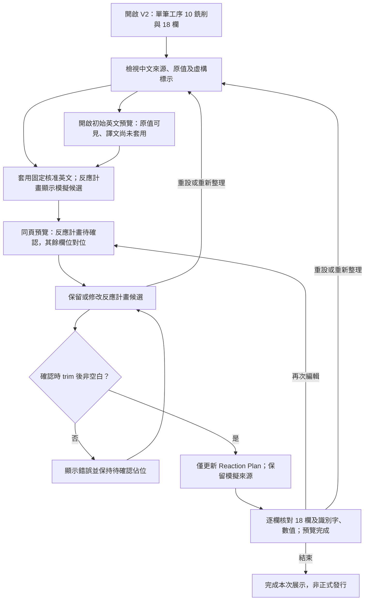

# Design

## Context

現有實作仍為 V1 的三列精簡表。V2 改版理由見 proposal.md，完整中英文與數值契約見 specs/process-doc-bilingual-sync/spec.md。使用者已確認保留 18 欄表頭，以單筆工序 10 銑削取代三列範例，且允許自製虛構尺寸與管制資料。

## Goals / Non-Goals

**Goals:** 單一完整製程列的來源與英文預覽逐欄一致；保留識別字、CCP 及數值字串；在 Reaction Plan 內修改並確認唯一模擬候選。

**Non-Goals:** 不接模型、Excel、後端或持久化，不產生正式製程判定、GR&R、製程能力或 DOE 結果。本次僅改規格。

## Operation Flow

初始預覽、空白、確認與再次編輯對應 spec 的同名情境；再次編輯只撤回 Reaction Plan。重複套用保持現有狀態，水平捲動可在任一表格檢視階段操作。流程已作結構與文字一致性檢查，未驗證 Mermaid 渲染。

## Decisions

1. **資料以穩定欄位鍵對位。** 在 src/fixture.ts 定義一筆 PCP-DEMO-002 與 18 欄描述（固定鍵、群組、中文、英文、來源類型），來源表與預覽共用欄位順序。相較按陣列位置另建英文表，可降低錯欄風險。原有三列僅存在 V1 歸檔與 Git 歷史，不新增 V1/V2 切換功能。
2. **固定英文與候選分離。** 13 個文字欄為虛構核准英文；4 個原值欄為工序、CCP、抽樣數量、DOE（DOE 說明另有固定英文）；唯一候選為 Reaction Plan。無模型產生或檢索。候選狀態以該欄位鍵保存，不使用第三列或工序 30 判斷。
3. **數值視為顯示字串。** 不 parse 成 number、不算上下限、不換算單位；規格 20.00 ± 0.02 mm、3 pcs 等精確值按 spec 保留。這是結果契約，不新增任意文件數值偵測能力。
4. **同頁雙表與寬表。** 保留 18 欄群組表頭及水平捲動，來源與英文預覽為兩個具可辨名稱的區塊。候選編輯與確認留在來源表 Reaction Plan；預覽同欄只顯示有效確認結果或佔位。來源標籤與確認狀態放在各欄內，不額外擴充成第 19 欄。桌面 1440 × 900、窄視窗 390 × 844 均可捲至最右欄。
5. **確認生命週期沿用。** 套用不覆蓋編輯；trim 後非空白才能確認。編輯即撤回確認，只有反應計畫從預覽移除，其他 17 欄維持原值。修改來源標記以 trim 後是否不同於固定候選判斷。重設及重新整理回到 V2 初始資料，不回到 V1。
6. **展示揭露。** 尺寸、抽樣、CCP 為虛構測試值；ΔP 不代表完成正式 CCP 分類。CCP Verification 是示範方式，不是通過結果。保留 V1 的非正式發行與未自動檢查翻譯品質提示。Excel 匯入／匯出不納入 V2。

## Risks / Trade-offs

- 寬表不易掃讀 → 共用表頭階層、可讀欄寬及水平捲動；測試按欄名比對，不只搜尋整頁文字。
- V1 寫死步驟或三列狀態可能污染 V2 → 更新 fixture 與狀態判斷，E2E 驗證唯一工序及反應計畫作用範圍。
- 虛構尺寸被視為正式規格 → 保留整頁虛構及非正式用途提示，不捏造研究結果。

## Migration Plan

無資料庫遷移；未來實作調整 fixture、表頭與狀態，再依 E2E 試走。回退以 V1 版本為準；既有歸檔證據不修改。尚未實作或部署。
