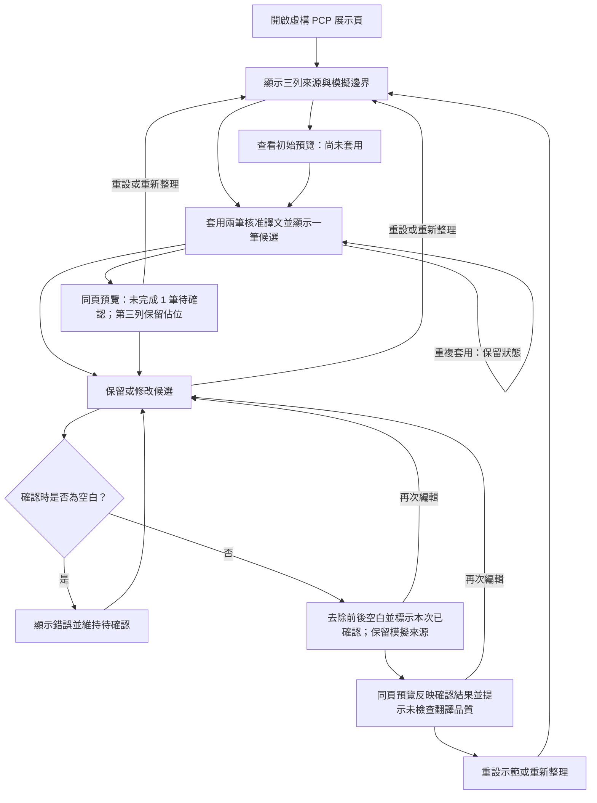

# Design

## Context

依據 proposal 與使用者補充的起步文件；目前沒有應用程式或既有主規格。建立此設計是為了先釐清模擬資料、確認狀態與結果衍生方式。CLI 讀得的專案 context 使用繁體中文與 TypeScript 技術棧。

## Goals / Non-Goals

**Goals:** 以桌面瀏覽器單頁互動示範一份 PCP，讓來源、核准譯文、候選與預覽同時可對照；由明確狀態衍生預覽，避免未確認文字誤入結果。

**Non-Goals:** V1 不接翻譯模型，不處理 Excel 匯入／匯出，也不建立後端、資料庫、正式審批或跨文件同步。這些均為本提案範圍決策，供使用者審查；不預建 V2。

## Operation Flow

入口為初始頁，亦可在套用前查看未完成預覽。「阻擋空白確認」分支回到編輯；「再次編輯撤回確認」使預覽同步回到未完成。完整預覽是此次展示的完成點，使用者可重設重走。對應 specs 的同名情境；重複套用保持狀態，不產生新的流程分支。

## Decisions

1. **本機前端原型。** 採 React + Vite、TypeScript strict、pnpm、Tailwind CSS，以 React Router 提供 `/` 展示頁。無遠端資料，因此不建立 TanStack Query 查詢、Express API 或 PostgreSQL；避免為固定資料引入不必要服務。相較靜態截圖，互動畫面可驗收確認是否真的影響結果。
2. **固定資料契約。** 內建 PCP-DEMO-001「虛構零件製程管制計畫」；三列步驟與完整中英文字、AP-001/AP-002 見 specs。fixture 分開存放中文來源、兩筆核准記憶與一筆候選，透過中文完整相等比對套用。候選預先撰寫成美式英文，無 AI 呼叫、信心分數或實際檢索；核准來源 ID 亦為模擬。相較接模型，此法可重複展示且不需帳號金鑰。
3. **狀態與預覽。** 每列初始為未套用；核准列可轉已套用，第三列轉待確認，再經 trim 後非空的文字確認為本次已確認。確認不是加入核准記憶。修改即清除確認結果；預覽從目前有效狀態衍生，不保存舊快照。核准文字唯讀，重複套用只更新核准列、不碰候選。
4. **畫面構成。** 頂部顯示 V1、文件 ID、模擬及模型／Excel 範圍提示；中段表格顯示步驟、中文、英文、狀態、來源；候選提供文字欄與「確認候選」。提供「套用核准譯文」、「英文預覽」、「重設示範」，確認按鈕在套用前不可用。預覽區列出所有步驟、佔位及完成標示，不提供上傳下載。操作說明明示重新整理不保留。
5. **展示順序與驗收。** 先展示初始來源與限制，再套用並辨認兩筆核准與一筆候選，先看未完成預覽，修改或保留候選確認，最後對照完整英文結果並重設。逐步通過條件以 specs 為契約、e2e-testing 為執行清單；後續展示說明／PPT 必須如實揭露固定候選、無模型、無 Excel 與非正式發行。本次不製作 PPT。
6. **審查確認的來源與預覽契約。** 表格及預覽分開顯示來源、狀態，以文字辨識，顏色只作輔助。核准來源顯示 ID 與虛構標記；候選確認後保留「模擬候選」，確認文字與固定候選去除前後空白後不同時，顯示「模擬候選，經人工修改」。英文預覽按鈕在同頁展開區塊，保留三列，候選英文留在編輯區；第三列未確認時顯示「待確認，尚未納入英文結果」，頂部為「未完成：1 筆待確認」。修改、確認、再次編輯、再次確認四個狀態皆需驗收，預覽與去除前後空白後的確認文字逐字一致，前兩列保持不變。
7. **確認範圍。** 僅作非空白與確認狀態驗證，不做語言辨識或翻譯品質判定。完成時同時顯示「預覽完成／非正式發行」與「已完成本次確認，未自動檢查翻譯品質」，英文品質由展示者人工檢查。

## Risks / Trade-offs

- 固定核准譯文可能被當成正式審核資料 → 所有畫面保留虛構資料標示，候選確認採不同名稱。
- 固定三列不能代表任意 PCP 翻譯品質或 Excel 相容性 → 展示說明明列限制，不宣稱正式資料驗證。
- 記憶體狀態重新整理即消失 → 顯示提示並提供重設，方便重複試走。

## Migration Plan

無既有資料與部署要遷移；後續實作只需本機啟動指引與 fixture。公開部署須另行提出，規格階段不執行。
